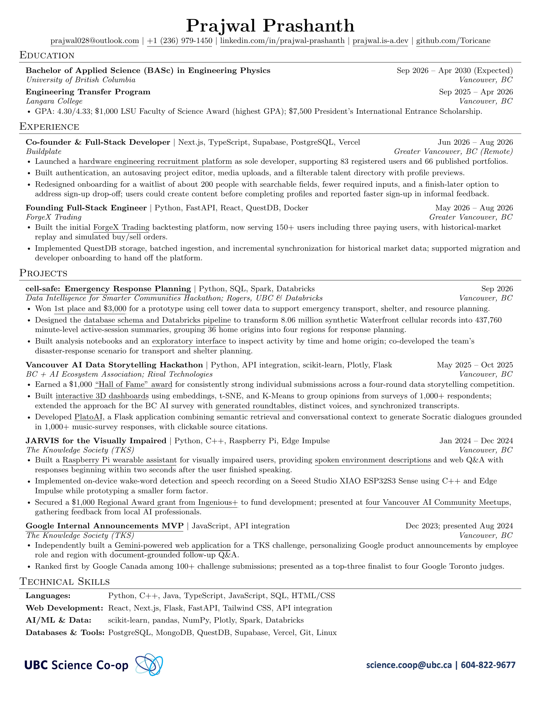

# Prajwal Prashanth — Resume

One-page Engineering Physics resume (UBC Science Co-op).

## Download

[**Download UBC co-op PDF**](Prajwal_Prashanth_UBC_2026-10-16_v2.pdf)

[**Download PDF without co-op footer**](Prajwal_Prashanth_2026-10-16_v2.pdf)

The stable site link is [https://prajwal.is-a.dev/resume](https://prajwal.is-a.dev/resume) (opens a browser viewer with a Download button).

Raw Markdown is available at [/resume/resume.md](https://prajwal.is-a.dev/resume/resume.md), which serves `resume.md` verbatim.

## Preview

---

To edit, autocompile, or publish a new version, see [EDITING.md](EDITING.md).
